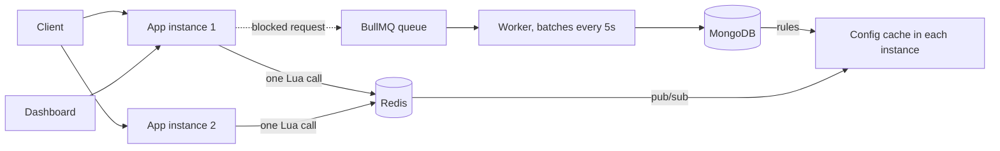

# Distributed Rate Limiter


A rate limiter for Express that keeps its counters in Redis, so any number of app instances share the same limits. I built it to understand what goes wrong when several servers count requests at the same time, and how to handle Redis going down. It has three algorithms, limits you can change while the server is running, a record of who got blocked, and a small React dashboard.

Built with Node.js, Express, Redis (Lua scripts), MongoDB, BullMQ, JWT and React.

## How it works

The obvious way to count requests is to read the counter, check it, then increment it. With two servers that breaks: both read 9, both allow request number 10. So each check here is a single Lua script. Redis runs a script without interruption, which means the read, the check and the update happen as one step and there is nothing to lock.



## The three algorithms

- **Fixed window** is a counter that expires at the end of the window. It is the cheapest, but a client can send a full burst at the end of one window and another at the start of the next.
- **Sliding window** keeps a timestamp for every request in a sorted set, so the limit holds over any stretch of time. It costs more memory, one entry per allowed request.
- **Token bucket** refills at a steady rate and allows short bursts up to the size of the bucket.

The sliding window and token bucket scripts read the time from Redis itself, so servers with slightly different clocks still agree.

`npm run demo:boundary` shows the fixed window problem. It sends a burst just before a window ends and another just after, with a limit of 10 per second:

```
fixed-window   : 19 requests allowed within 116ms
sliding-window : 10 requests allowed within 115ms
```

## When Redis is down

Each route decides what to do. Most routes fail open: the request goes through and the response gets an `X-RateLimit-Status: bypassed` header, because a broken limiter shouldn't take the whole API down with it. A route like login fails closed and returns 503, because letting unlimited password guesses through is worse than turning people away for a moment.

The Redis client doesn't queue commands while it's disconnected, and each limiter call has a 250 ms timeout, so the decision is made quickly. `test/failure.test.js` starts a real Redis, kills it in the middle of the test, checks both behaviours, starts it again and checks that limiting resumes.

## Changing limits while it runs

Limits can be overridden through the admin API, and the dashboard has a form for it.

```
PUT /admin/rules/search   { "limit": 5 }
PUT /admin/rules/search   { "enabled": false }
```

Overrides are stored in MongoDB. Each instance keeps a copy in memory so requests never wait on the database, and the admin API sends a Redis pub/sub message so other instances reload straight away. They also refresh every 30 seconds in case a message is missed, and if a refresh fails they keep using the last rules they had.

The admin API checks the final configuration before saving anything. For example, switching a fixed-window route to token bucket without a bucket size and refill rate is rejected with a 400. If a bad rule ends up in the database some other way, the limiter ignores it, logs a warning and uses the defaults from the code.

## Recording blocked requests

Every blocked request is pushed onto a BullMQ queue, without making the client wait. A worker groups them by route, client and minute and writes the groups to MongoDB every 5 seconds, so a burst of thousands of blocked requests becomes a handful of writes.

A job is only marked done after its batch has been written to MongoDB. If the worker is killed first, BullMQ gives the job to another worker, and if MongoDB is down the jobs are retried with a growing delay. Nothing is lost, but a crash between the write and the acknowledgement can count one batch twice. For an audit log I preferred that to losing events.

## Auth, API keys and proxies

Authenticated routes use JWTs and limit by the user ID in the token, not the IP address. Admin routes need a token with the admin role. In development, `GET /dev/token?role=admin` hands out a token. That route is switched off when `NODE_ENV=production`.

API keys are hashed (HMAC-SHA256 with a secret) before they are used anywhere, so the raw key never appears in Redis, the queue, MongoDB or the dashboard. That's why the dashboard shows names like `key:1351daf8b0da648a`. The secret is `IDENTITY_SECRET`, or something derived from `JWT_SECRET` if you leave it empty. Every instance has to use the same one. In development, `GET /dev/identity?key=alice` shows which hash a key turns into. User IDs and IP addresses are shown as they are.

Behind a reverse proxy every request seems to come from the proxy, so all clients would share one IP limit. Set `TRUST_PROXY` to say which proxies to believe:

- empty or `false`: trust nobody and use the socket address (the default)
- a number such as `1`: trust that many proxies in front of the app
- addresses or ranges such as `10.0.0.0/8`, or `loopback`: trust only those
- `true`: refused at startup, because then any client could send a fake `X-Forwarded-For` and pick its own IP

## Running it

You need Node 22 (the test command uses a glob that needs Node 21 or newer), plus Redis and, optionally, MongoDB. The easiest way to get both is Docker.

```bash
docker compose up -d
cd server
cp .env.example .env
npm install
npm start
```

In a second terminal:

```bash
cd dashboard
npm install
npm run dev
```

The API runs on port 3000 and the dashboard on 5173. If you leave `MONGO_URI` empty in `.env`, the server runs without MongoDB: overrides are kept in memory and blocked requests are just logged. On Windows, use `copy` instead of `cp`.

A quick check, which should print ten 200s and then 429s:

```bash
for i in $(seq 1 12); do curl -s -o /dev/null -w "%{http_code} " -H "x-api-key: demo" localhost:3000/api/public; done
```

| Route | Limit | Counted by |
|---|---|---|
| `GET /api/public` | 10 per minute (fixed window) | API key, or IP |
| `GET /api/search` | 20 per 10 seconds (sliding window) | API key, or IP |
| `GET /api/spike` | burst of 10, then 2 per second (token bucket) | API key, or IP |
| `POST /api/login` | 5 per minute, fails closed | IP |
| `GET /api/account` | 20 per minute, needs a JWT | user ID |

Other scripts in `server`: `npm run demo:load` sends a mix of well-behaved and abusive traffic so the dashboard has something to show (it prints which hash belongs to which client), `npm run demo:boundary` runs the comparison above, and `npm run bench` measures latency.

## Deploying to Render

I run the API as a Render web service and the dashboard as a static site. They end up at different addresses, which matters in two places: the dashboard has to know where the API is, and the API has to allow requests from the dashboard's address.

For the API, create a web service with root directory `server`, build command `npm install` and start command `npm start`. Set these environment variables:

- `NODE_ENV=production`
- `REDIS_URL`, the connection string from your Redis provider. Upstash gives a `rediss://` URL, and the double s means TLS, so keep it.
- `MONGO_URI`, the Atlas connection string. In Atlas, under Network Access, allow Render's addresses (`0.0.0.0/0` is the easy option on a free cluster).
- `JWT_SECRET`, a long random string. The server refuses to start in production with the default one.
- `CORS_ORIGIN`, the exact address of the dashboard, for example `https://my-dashboard.onrender.com`. No wildcard, no path.
- `TRUST_PROXY=1`, because Render puts a proxy in front of the app and I want the real client IP, not the proxy's.

For the dashboard, create a static site with root directory `dashboard`, build command `npm install && npm run build` and publish directory `dist`. Set `VITE_API_URL` to the API's address with no trailing slash. Vite reads it while building, so if you change it, redeploy with the build cache cleared.

Visiting the API's root address shows a small JSON status, and `/health` returns `{"ok":true}`. The dashboard needs an admin token, and the `/dev/token` shortcut is switched off in production. Make one on your own machine with the same `JWT_SECRET` the server uses and paste it into the dashboard's sign-in box:

```bash
cd server
JWT_SECRET=your-secret npm run admin-token
```

On PowerShell, use `$env:JWT_SECRET="your-secret"; npm run admin-token`. Tokens last 8 hours by default.

Limits by IP address only work if the server sees the real client address. Render sends traffic through Cloudflare and its own load balancers, so `req.ip` can be a proxy address that changes from request to request, and then every request looks like a new client. Limits by API key or by user don't have this problem. `GET /admin/whoami` (admin token required) shows what the server receives: the socket address, the forwarding headers and the address the limiter would use. If the real client address turns up in a header such as `cf-connecting-ip`, set `CLIENT_IP_HEADER` to that header's name. Only do this when every request really arrives through the proxy that sets the header, because otherwise a client could send the header itself and choose its own address.

A few things I ran into or expect to:

- Free Render web services go to sleep when idle, so the first request after a break can take a while.
- If Redis is in a different region from the API, each check takes longer and the 250 ms limit can be too tight. The symptom is the "Let through while Redis was down" number climbing on the dashboard. Raise `LIMITER_TIMEOUT_MS`, or move Redis closer.
- The dashboard polling and the BullMQ worker make a steady stream of Redis calls, so keep an eye on the command limit of a free Redis plan.

## Tests

`npm test` in `server` runs 60 tests against a real Redis and a real MongoDB, with no mocks for either. They need Redis on `localhost:6379` and MongoDB on `localhost:27017`, or set `REDIS_URL` and `MONGO_TEST_URI`. The MongoDB tests use a throwaway database and are skipped, with a message, if no MongoDB is reachable.

They cover:

- the algorithms, including 500 concurrent requests allowing exactly the limit
- the HTTP responses and headers, and the JWT and admin checks
- the config cache, the pub/sub reload and the admin API validation
- the queue: a worker that dies without finishing gets its jobs redelivered, and a failing database causes retries instead of loss
- MongoDB: rule storage, indexes, 40 writers updating the same counter without losing an increment, and the full path from a blocked request to a MongoDB row
- API keys never showing up in Redis, the queue, MongoDB or the dashboard data
- the Redis outage test, which uses a local `redis-server` if there is one on the PATH and otherwise starts a temporary Docker container, so it runs on Windows too

## Performance

`npm run bench` alternates 1000 requests to a route with no limiter and a route with the full limiter, over localhost, and reports the difference.

<!-- TODO: replace with the output of `npm run bench` on your own machine -->
```
added latency   p50 0.30ms   p95 2.34ms   p99 5.49ms
```

The tail (p99) changes a lot from run to run on a laptop. Over a real network the cost is mostly the round trip to Redis.

## Something that went wrong

My first tests showed limits not being enforced at all. The Redis client doesn't queue commands before it has connected, so the first requests failed, and because those routes fail open they were let through quietly. I fixed it by waiting for the connection at startup, and bypassed requests now show up in the metrics so this can't hide again.

## Limitations

- Blocked-request counts are at-least-once, so a crash at the wrong moment can double-count one batch. If Redis is unreachable when a request is blocked, that event isn't queued.
- It uses a single Redis node. I haven't tried Redis Cluster, and with a failover the counters can briefly forget recent requests.
- The sliding window uses memory in proportion to the limit. For very high limits, a counter-based approximation would be a better choice.
- Metrics are simple per-minute counters, and the dashboard polls every 3 seconds instead of using websockets.
- Two admins editing the same route at the same instant can overwrite each other.

## Layout

```
server/src/lua         the three algorithms
server/src/limiter     middleware, config validation, API key hashing
server/src/config      rule storage and the config cache, proxy setting
server/src/queue       BullMQ producer, batching and worker
server/test            integration tests
server/scripts         demo, load and benchmark scripts
dashboard              React + Vite dashboard
```
